<a href="https://github.com/bibek-cse/bibek-cse">
  <picture>
    <source media="(prefers-color-scheme: dark)" srcset="https://raw.githubusercontent.com/bibek-cse/bibek-cse/main/dark_mode.svg">
    
  </picture>
</a>

<p align="center">
  <a href="https://in.linkedin.com/in/bibek6612"></a>
  <a href="https://www.kaggle.com/bibekcse"></a>
  <a href="mailto:bibekdas.cse@gmail.com"></a>
  
</p>

<p align="center"><b>I make images and videos verifiable, and I catch them when they aren't.</b><br/>
<sub>Research Scholar · CSE · IIT Patna · computer vision &amp; media forensics</sub></p>

---

### 🗂️ Case files

| | Line of inquiry | What I'm asking |
|:-:|---|---|
| 🛡️ | **Provenance** | Can a watermark survive compression, editing, and an adversary trying to remove it? Who made this image? |
| 🕵️ | **Forensics** | Is this face real? *Where* exactly was this image changed, and can the model show why it thinks so? |
| 🧠 | **Vision-language** | How far can VLMs go zero-shot as detectors and counters, and where do they fail? |

📄 Publishing at **ICPR**, **ICONIP** and **IEEE TBIOM**.

### 🧾 Exhibits

| Exhibit | | |
|:-:|---|---|
| **A** | [**Watermark_Attack**](https://github.com/bibek-cse/Watermark_Attack) | A toolkit of traditional and learning-based attacks for stress-testing image watermarks |
| **B** | [**Deepfake_Detection**](https://github.com/bibek-cse/Deepfake_Detection) | Deepfake detection experiments and pipelines |
| **C** | [**VisionCrowdTest**](https://github.com/bibek-cse/VisionCrowdTest) | Benchmarking vision-language models for zero-shot crowd counting |
| **D** | [**AI GATE Quest**](https://bibek-cse.github.io/ai-gate-quest/) | A game that teaches ML, DL, LLMs, DSA and maths for AI one question at a time |
| **E** | [**Image Edit Studio**](https://github.com/bibek-cse/image-edit-studio) | A free browser front-end for open image-editing models (Qwen-Image-Edit, FLUX Kontext, SDXL) |

### 🎭 Two truths and a deepfake

1. I teach Java & DSA labs, and I turn the lab quizzes into games for my students.
2. The portrait in the card is my real photo, drawn only with 0s and 1s, and those digits spell out my bio.
3. I once trained a detector so good it flagged my own selfie as fake.

<details>
<summary><b>Reveal the deepfake</b></summary>
<br/>

**#3 is the fake.** My detectors still think I'm real (`face_0 · REAL · 0.997`). The other two are true.
</details>

### 🔍 Decode the card

The card at the top hides two messages, the same idea I work on, scaled down to something you can decode by hand.

1. **The portrait is data.** Every 0 and 1 in my face is one bit. Brightness only changes how strongly a digit is drawn.
2. **There's an invisible watermark.** 40 near-invisible cells sit along the bottom edge of the card.

<details>
<summary><b>Hints</b></summary>
<br/>

Open the raw SVG. For the portrait, read the digits row by row, left to right (sort by <code>y</code>, then <code>x</code>), 8 bits per ASCII character. For the watermark, a cell that's present is a <code>1</code> and a gap is a <code>0</code>, read MSB first.
</details>

<details>
<summary><b>Solution</b></summary>
<br/>

```python
import re, requests
svg = requests.get("https://raw.githubusercontent.com/bibek-cse/bibek-cse/main/dark_mode.svg").text

# 1) the portrait
cells = []
for y, xs, ds in re.findall(r'<text class="[pb][b0-9]" y="([\d.]+)" x="([^"]+)">([01]+)</text>', svg):
    cells += [(float(y), float(x), d) for x, d in zip(xs.split(), ds)]
bits = "".join(d for *_, d in sorted(cells))
print(bytes(int(bits[i:i + 8], 2) for i in range(0, len(bits) - 7, 8)).decode())

# 2) the watermark
wm = svg.split('<g id="wm"')[1].split("</g>")[0]
x0, w = (985 - 240) // 2, ["0"] * 40
for x in map(int, re.findall(r'x="(\d+)"', wm)):
    w[(x - x0) // 6] = "1"
w = "".join(w)
print("".join(chr(int(w[i:i + 8], 2)) for i in range(0, 40, 8)))
```
</details>

### 🛠️ Lab equipment

<p>
  
  
  
  
  
  
  
  
</p>

---

<p align="center"><sub><i>"Your work reflects your character."</i> · verdict: <b>authentic</b></sub></p>
